# Island

A Dynamic-Island-style status pill for [Hyprland](https://hypr.land), built with
[Quickshell](https://quickshell.org). It sits at the top-center of the screen and morphs, with a
spring animation, into whatever is happening: music playing, a Claude Code session waiting for you,
a message pushed from a script. Hovered or expanded, it attaches to the top edge of the screen with
concave flares that ease into the edge.

Everything the island shows is a **module**, and modules, scripts and hooks are all extensible
without touching this repository.

Tested on Arch Linux with Hyprland 0.56.2, Quickshell 0.3.1 and Qt 6.11.

<p align="center">
  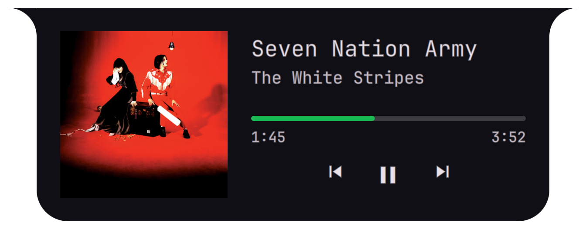
</p>

## Showcase

Every image below is drawn at the same scale, 1.5 times the size it has on a 1080p screen, so a
collapsed pill stays as small next to an expanded view as it is on the desktop. Music is a real Spotify
session; the F1, Discord, Claude and card shots use sample data.

**One pill, three states.** Collapsed in the bar, a summary on hover, the full view when clicked.

<p align="center">
  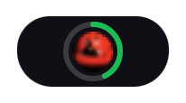
  &nbsp;&nbsp;
  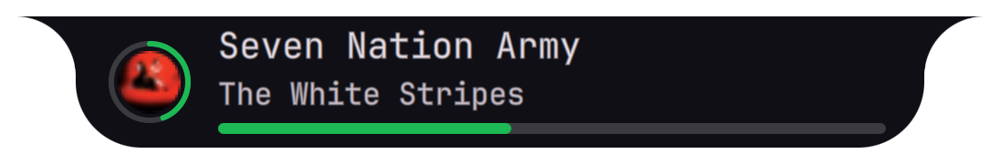
</p>

**F1 live timing.** Position, sector colours and last lap on the pill; minisectors, tyres and gaps for
two drivers when expanded.

<p align="center">
  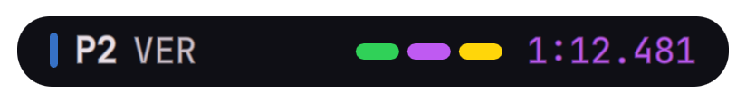
</p>
<p align="center">
  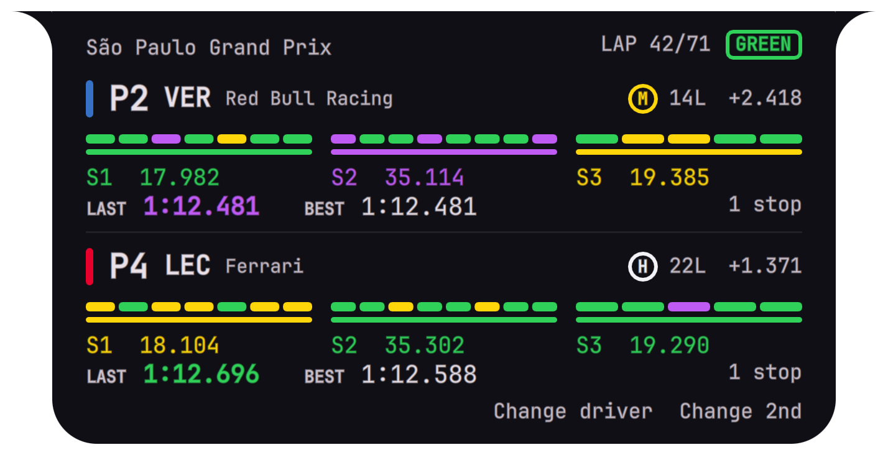
</p>

Race events take over the island for a few seconds: safety car, lights out, pit stops, penalties, and
a coloured ring when your driver gains or loses a place.

<p align="center">
  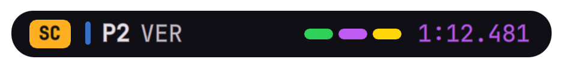
  &nbsp;
  
</p>
<p align="center">
  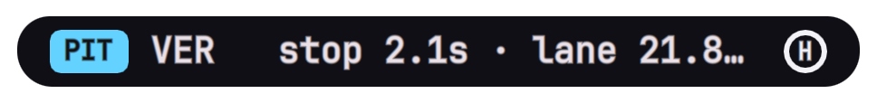
  &nbsp;
  
</p>
<p align="center">
  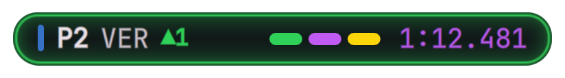
</p>

**Discord call.** Call length on the pill, who is in the channel (and who is talking) on hover, and
mic, deafen, camera and leave when expanded.

<p align="center">
  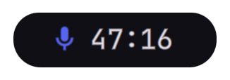
  &nbsp;&nbsp;
  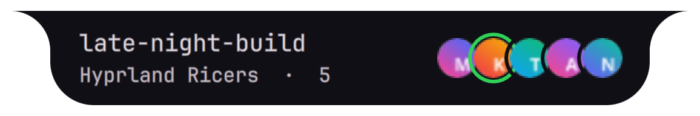
</p>
<p align="center">
  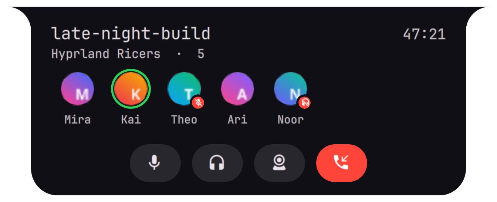
</p>

**Claude Code sessions.** Orange while working, red when a session needs you, green when it is done;
expanded, every session with its state and how long it has been in it.

<p align="center">
  
  &nbsp;
  
  &nbsp;
  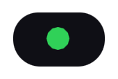
</p>
<p align="center">
  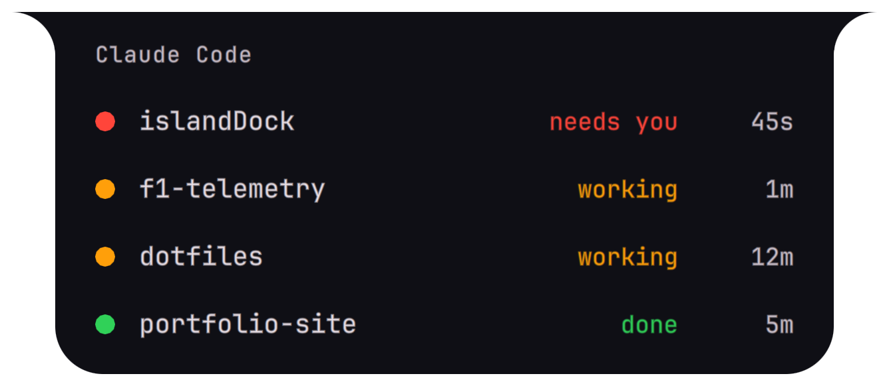
</p>

**Two things at once.** The runner-up becomes a bubble beside the pill; click it to swap.

<p align="center">
  
  &nbsp;&nbsp;
  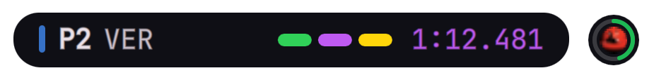
</p>

**Cards from any script.** `island-ctl push` shows a title, icon and optional progress bar.

<p align="center">
  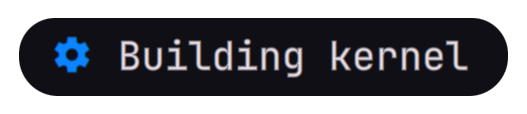
  &nbsp;&nbsp;
  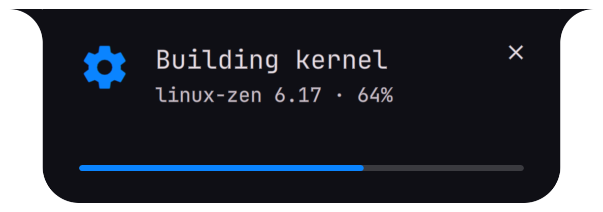
</p>

## Contents

- [Showcase](#showcase)
- [Features](#features)
- [Requirements](#requirements)
- [Installation](#installation)
  - [Choosing modules](#choosing-modules)
- [Usage](#usage)
- [Built-in modules](#built-in-modules)
  - [F1 live timing](#f1-live-timing)
  - [Discord call](#discord-call)
- [Configuration](#configuration)
- [Extending Island](#extending-island)
  - [Writing a module](#writing-a-module)
  - [Scripts as data sources](#scripts-as-data-sources)
  - [Window data](#window-data)
  - [Event hooks](#event-hooks)
- [Claude Code integration](#claude-code-integration)
- [Architecture](#architecture)
- [Performance](#performance)
- [Development](#development)
- [Troubleshooting](#troubleshooting)
- [Known limitations](#known-limitations)
- [License](#license)

## Features

- **Three states, one shape.** Collapsed pill, hover, and an expanded view that is flush with the top
  of the screen. Width, height and corner shape animate as one spring-driven silhouette.
- **Click-through.** Only the pill, its side bubble and the clock take mouse input; the rest of the top
  edge stays clickable.
- **Modular.** A module is a folder with a `manifest.json` and a QML file. Drop it into
  `~/.config/island/modules/`, and it gets a generated page in Settings. Disabled modules are never
  loaded, so they cost nothing.
- **Priority and bubbles.** When two modules are live, the higher priority takes the pill and the
  runner-up becomes a small bubble beside it. A module can mark itself urgent to take over at once.
- **Scripts and hooks.** Feed a module from any script or API with a manifest `source`, and run your own
  executables whenever an event fires (track changed, window focused, Claude session needs you...).
- **Window awareness.** Focused window, open windows and workspace events are available to modules,
  scripts and hooks.
- **Settings panel.** Enable and disable modules, reorder them, edit every option, manage hooks, tune the
  look. Every change is saved immediately and hot-reloaded.
- **Standalone clock.** Centered while the island is idle, to the right of it while the island is
  showing something, and hidden in fullscreen.
- **Light.** No polling; timers run only while something visible needs them. See
  [Performance](#performance).

## Requirements

- Hyprland, running in hyprlang (`hyprland.conf`) mode
- Quickshell 0.3 or newer (Qt 6; tested with 6.11)
- `jq`, `curl`
- Python 3 (installer and tests only)
- A Nerd Font (`JetBrainsMono Nerd Font` by default; configurable)
- Optional: `qt6-shadertools` to rebuild the shader, `playerctl` for testing the music module

Hyprland's Lua config mode is not covered: the island itself runs, but the installer edits hyprlang
files and `island-ctl focus` is untested there.

## Installation

```sh
git clone https://github.com/TiElixir/hypr-island.git && cd hypr-island

scripts/install.sh --dry-run     # show exactly what would change
scripts/install.sh               # links, config, module choice, Hyprland rules, Waybar
scripts/install.sh claude        # optional: Claude Code hooks (new sessions only)

hyprctl reload && killall -SIGUSR2 waybar
qs -c island                     # or log out and in; it autostarts afterwards
```

Run from the repository during development instead with `qs -p quickshell/island`.

### Choosing modules

The installer asks which [built-in modules](#built-in-modules) you want. Type the numbers to tick or untick,
and press Enter to keep the list:

```
modules
    1 [x] Claude Code              Status of your Claude Code sessions
    2 [ ] Discord call             Your current Discord voice call
    3 [x] Cards (island-ctl push)  Temporary cards pushed by any script with island-ctl push
    4 [ ] F1 Live                  Live race timing for your driver from F1's free live-timing feed
    5 [x] Music (MPRIS)            Now playing from Spotify or any MPRIS player
    6 [ ] Active window            Flashes the focused window's app and title when focus changes
  numbers to tick or untick, Enter when done: 4
```

A module you leave out is never loaded and does not show up in Settings. Its settings are kept, so it comes
back as it was. A module you tick is switched on. To change the choice later, with the island running or not:

```sh
scripts/install.sh modules                           # ask again
scripts/install.sh --modules spotify,claude modules  # no questions: exactly these ids
scripts/install.sh --modules all modules             # or: none
```

`--modules` also works for a whole unattended install (`scripts/install.sh --modules spotify,f1`). Without a
terminal to ask and without `--modules`, the step leaves the choice as it is. The choice is stored as
`skipModules` in `~/.config/island/config.json`.

### What the installer changes

Everything outside this repository that it touches, and how to undo it:

| File | Change | Undo |
|---|---|---|
| `~/.config/quickshell/island` | symlink to `quickshell/island` | removed |
| `~/.local/bin/island-ctl` | symlink to `bin/island-ctl` | removed |
| `~/.config/island/config.json` | your settings (created once, never overwritten; the modules step only changes `skipModules` and switches ticked modules on) | removed |
| `~/.config/hypr/UserConfigs/Startup_Apps.conf` | `exec-once = qs -c island` | marker block removed |
| `~/.config/hypr/UserConfigs/WindowRules.conf` | blur rules for the `island` and `island-settings` layers | marker block removed |
| `~/.config/hypr/UserConfigs/UserKeybinds.conf` | `SUPER+ALT+I` toggles the island, `SUPER+ALT+S` opens Settings | marker block removed |
| Waybar config (target of `~/.config/waybar/config`) | `clock` and `custom/swaync` leave the top bar's center; swaync moves to the right | `.bak-island` restored |
| `~/.claude/settings.json` | 12 hook entries (backup: `settings.json.bak-island`) | exactly those entries removed |

Edits are wrapped in `# >>> island >>>` / `# <<< island <<<` markers and are refreshed when you re-run
the installer. The Hyprland files are the user-owned ones of KooL's Hyprland-Dots, so upgrades of the dots
leave them alone; the Waybar file is dots-managed, so re-run `scripts/install.sh waybar` after an upgrade.
Runtime state lives in `$XDG_RUNTIME_DIR/island/` and `~/.cache/island/art/`.

### Uninstall

```sh
scripts/uninstall.sh             # then: hyprctl reload && killall -SIGUSR2 waybar
scripts/uninstall.sh --keep-config
```

`~/.config/island/modules/` and `hooks/` are yours: they are never deleted while they contain files.

## Usage

### Keybinds

| Keys | Action |
|---|---|
| `SUPER` + `ALT` + `I` | Toggle the island open or closed |
| `SUPER` + `ALT` + `S` | Open Settings (press again to close) |

Pointer: hover the pill to grow it, click to expand, move away or click it again (anywhere but a button) to
collapse. Click the side bubble to
bring the runner-up module to the front. Right-click the clock to open Settings.

### Settings

Open with `SUPER+ALT+S`, `island-ctl settings [tab]`, or by right-clicking the clock. Esc, the close
button, or a click outside closes it. Each setting gets a reset arrow once you change it.

| Tab | What it does |
|---|---|
| General | Which monitor, stay above fullscreen windows, the clock, hover timings |
| Modules | Switch modules on or off, reorder them (arrows or priority number), see their status, edit their options |
| Hooks | Discovered hook scripts with on/off and test buttons, the event catalog, a live event log |
| Appearance | Opacity, font, sizes (hover and expanded), edge flare, colours, spring, window area |
| Advanced | File locations, rescan, open the config in your editor, restart, reset everything |

### `island-ctl`

A small CLI for scripts and keybinds.

```sh
island-ctl push --id vol --title "Volume 40%" --icon 󰕾 --progress 40 --timeout 2
island-ctl push --id build --title "Build failed" --subtitle "exit 2" --color "#FF453A" --timeout 0
island-ctl clear --id build            # or --all
island-ctl list                        # active cards and Claude sessions
island-ctl toggle | expand | collapse | swap
island-ctl settings [tab]
island-ctl modules                     # enabled, priority and status per module (or "not installed")
island-ctl module enable|disable|up|down <id>
island-ctl module priority <id> <n>
island-ctl reload                      # rescan modules and hook scripts
island-ctl windows | focused           # window data as JSON
island-ctl emit <event> [json]         # put an event on the bus (runs hooks)
island-ctl config get [path] | set <path> <json> | reset <path>    # dotted path
island-ctl keep-on-top on|off|toggle|config [--save]
island-ctl status | focus <pid> | restart
```

`--icon` takes a Nerd Font glyph, an emoji or an absolute image path. `--timeout 0` keeps a card until it
is cleared or dismissed. Cards are files, so pushing works while the island is stopped.

`config set` takes any JSON value, quoted for the shell:
`island-ctl config set clock.format '"h:mm AP"'` or
`island-ctl config set modules.spotify.options.playerPriority '["spotify","*"]'`.

## Built-in modules

| Module | Priority | What it shows |
|---|---|---|
| **Music** (`spotify`) | 60 | Now playing from Spotify or any MPRIS player: art with a progress ring, title and artist on hover, and a seekable player with transport controls when expanded. Prefers Spotify; the order is configurable |
| **Claude Code** (`claude`) | 55 (100 when red, 40 when done) | One dot for the most important session state, a list of every session when expanded. See [Claude Code integration](#claude-code-integration) |
| **Cards** (`external`) | 70 | Temporary cards pushed with `island-ctl push`, with optional progress bar |
| **Active window** (`windowfocus`) | 62 | Flashes the focused window's app and title when focus changes; lists every open window when expanded. Off by default |
| **F1 Live** (`f1`) | 66 | Live race timing for your driver: sector colours, race status, formation lap and lights out, pit stops, penalties, position changes. Off by default. See [F1 live timing](#f1-live-timing) |
| **Discord call** (`discord`) | 64 | Your current voice call: its length on the pill, channel and participants on hover, mic, deafen, camera and leave when expanded. Off by default, needs a one-time setup. See [Discord call](#discord-call) |

The clock is not a module; see [Configuration](#configuration). The installer lets you leave out any of
these; see [Choosing modules](#choosing-modules).

### F1 live timing

Tick **F1 Live** when the installer asks (or later: `scripts/install.sh modules`). If it was installed
but switched off, enable it in Settings > Modules (or `island-ctl module enable f1`). Then expand the island during
a session and pick your driver, or set **My driver** (`44` or `HAM`) in its settings. **Add 2nd driver**
in the expanded island (or **Second driver** in Settings) shows a second car below yours, with its
minisectors, sector times, last and best lap. Switching drivers is instant: the feed carries every car.

Data comes from F1's own live-timing feed (`livetiming.formula1.com`), the source OpenF1 and FastF1 are
built on. It is free and needs no account; OpenF1's free tier only serves finished sessions. The module's
script (`modules/f1/f1feed.py`, Python standard library only) connects while a session is on or within an
hour of its start, and checks again every 10 minutes otherwise. It shows nothing between sessions.

Every part is a switch in the module's settings, so you can turn them on and off during a race:

| Switch | What you get |
|---|---|
| Lap times island | Position, three sector bars and the last lap, coloured purple (overall best), green (personal best) or yellow. Hover for sector times, tyre and interval; expand for minisectors, best lap, gaps and stops |
| Race status | Yellow flag (with sectors), VSC, safety car, red flag and chequered flag: a popup and a pulse when it changes, and a chip on the pill while it lasts |
| Formation lap | A grey **FORM** chip on the pill while the cars are on the formation lap, with a popup when it starts |
| Lights-out pulse | Five red lights go out on the pill with *LIGHTS OUT* and a green pulse. *RESTART* when a race resumes after a red flag |
| Pit stop popup | When your driver pits: *BOX BOX* on pit entry, then the new compound, stop time and pit lane time |
| Penalty popup | Time, drive-through and stop-and-go penalties, for all drivers or only yours |
| Position pulse | A green ring when your driver gains a place, red when one is lost, with a small ▲/▼ badge |

**Feed delay** holds everything back by up to 180 s so the island matches a TV or stream that runs behind
live timing; change it during a race and it pauses or catches up without reconnecting. (The `f1.*` bus
events for hooks are not delayed.) **Sessions** picks Grands Prix and sprints only (default) or practice
and qualifying too. The module emits
`f1.status` (`code` `formation` for the formation lap), `f1.start` (lights out; `restart` after a red flag),
`f1.pit`, `f1.penalty` and `f1.position`, so [event hooks](#event-hooks) can react to them.
F1 sends no formation-lap message, so the module works it out: a race that hasn't started, past its
scheduled start time, with at least three cars being timed on track. The reconnaissance laps before the
start don't count, and an extra formation lap shows the same way.
The feed is unofficial and undocumented; if F1 changes it, the module shows nothing until it is updated.
Stop times come from F1's pit-stop feed, which is not published for every race; the popup then shows the
lane time only.

### Discord call

While you are in a Discord voice channel or call, the island shows it:

| State | What you see |
|---|---|
| Collapsed | A mic icon (red and slashed while you are muted or deafened) and how long the call has lasted |
| Hover | The channel name, the server and head count, and the participants' avatars (a green ring while someone talks) |
| Expanded | Everyone with their name, mute and deafen badges, and the controls: **mic**, **deafen**, **camera** and **leave** |

The mic and deafen buttons follow Discord's real state, so they stay right when you use Discord's own
buttons or keybinds. Clicking the mic while deafened undeafens, like Discord's own. Nothing is shown outside
a call.

**Setup.** Discord only lets an application you registered talk to your client, so there is a one-time step
(a free developer app; nothing is published):

1. Create an application at <https://discord.com/developers/applications>.
2. Under **OAuth2**, copy the **Client ID** and reset and copy the **Client Secret**, and add
   `http://localhost` under **Redirects** (nothing is ever opened there).
3. Tick **Discord call** in the installer (`scripts/install.sh modules`), or enable it in Settings > Modules
   (`island-ctl module enable discord`), and enter the ID and secret there. The secret is stored in
   `config.json` as plain text.
4. With Discord running, the island shows *Approve Island in Discord*. Press **Authorize** in the Discord
   window. This happens once. The login is kept in `~/.config/island/discord-token.json` (mode 600); delete
   that file to authorise again, or revoke it under Discord's *Authorized Apps*. If Discord refuses the
   `rpc` scope, add your own account under the app's **App Testers**.

**Camera.** Discord's local API has no camera control, so the camera button presses the key you bound to it
instead. Bind one in Discord (*User Settings > Keybinds*, if your client offers a camera action), enter it
as **Camera shortcut** (`CTRL SHIFT, V` or `CTRL+SHIFT+V`), and the island sends it to the Discord window
with Hyprland's `sendshortcut`, focused or not. **Discord window class** picks the window (`discord`;
`island-ctl windows` shows yours). While the shortcut is empty the camera button is hidden. The button has
no on/off state, because Discord does not report the camera.

Discord does not say when a call began, so the length counts from when you joined it while the island was
running. If the island restarts, it keeps counting from the same start when it comes back within two minutes.
The module's script (`modules/discord/discordfeed.py`, Python standard library only) looks for Discord's
socket every 5 s while Discord is not running, and is otherwise driven by Discord's events. The official
client, its Flatpak and its Snap are looked for; Vesktop and other clients without Discord's own RPC server
do not work. Events for hooks: `discord.join`, `discord.leave` (with `seconds`) and `discord.voice` (`mute`,
`deaf`).

## Configuration

`~/.config/island/config.json` is deep-merged over the defaults in
`quickshell/island/core/Config.qml`. Edit it by hand (it is hot-reloaded; while it doesn't parse, the
island keeps the last good settings) or through Settings, and put only what you want to change in it. Per-module settings live under `modules.<id>`:

```json
{
  "clock": { "format": "h:mm AP" },
  "sizes": { "expandedScale": 1.3 },
  "modules": {
    "spotify": { "enabled": true, "priority": 80, "options": { "pausedLingerSec": 10 } }
  }
}
```

| Key | Default | Meaning |
|---|---|---|
| `monitor.policy`, `monitor.name` | `"focused"`, `""` | `"focused"`, `"primary"` (uses `name`) or `"all"` |
| `layer.keepOnTop` | `true` | `true`: overlay layer, stays above fullscreen windows. `false`: normal layer, fullscreen windows cover it |
| `clock.enabled`, `format`, `hideInFullscreen`, `gap` | on, `HH:mm:ss`, on, 14 | The standalone clock (a Qt date format). Without an `s` in `format` it only wakes once a minute |
| `sizes.hoverScale` | 0.85 | Hover views are drawn at this fraction of their design size |
| `sizes.expandedScale` | 1.2 | Expanded views are drawn this much larger than their design size |
| `sizes.flare` | 22 | Radius of the concave flares into the top edge (0 removes them) |
| `sizes.collapsedHeight`, `sizes.maxRadius` | 24, 24 | Pill geometry |
| `window.width`, `height`, `marginTop` | 920, 460, 3 | Upper limit of the invisible window the pill moves in (the window is only as big as what is shown) |
| `timings.hoverInMs`, `hoverOutMs` | 80, 250 | Hover intent and leave delay |
| `timings.expandedLeaveMs`, `expandedIdleMs` | 600, 5000 | Expanded collapses this long after the pointer leaves, or when never hovered |
| `timings.collapseOnLeave` | `true` | Turn off to keep it expanded until toggled |
| `behavior.focusGrab` | `false` | Experimental click-outside-to-collapse. On Hyprland 0.56 it stops hover from being reported while expanded |
| `spring.spring`, `damping`, `epsilon` | 3.2, 0.44, 0.5 | Animation feel. Lower damping is bouncier but keeps the compositor redrawing for longer |
| `colors.bgAlpha` | 0.9 | Background opacity. Blur comes from the Hyprland layer rule |
| `colors.running`, `needsInput`, `done` | orange, red, green | Claude status colours |
| `font.family`, `font.size` | JetBrainsMono Nerd Font, 13 | |
| `hooks.enabled`, `timeoutSec`, `minIntervalMs`, `disabled` | on, 10, 250, `[]` | The event hook runner |
| `modules.<id>.enabled`, `priority`, `options` | from the manifest | Per-module settings |
| `skipModules` | `[]` | Built-in module ids left out by the installer: not loaded, not in Settings. Set by `scripts/install.sh modules` |

Older configs with flat `spotify`, `claude`, `external`, `enabled` and `priorities` keys are migrated
automatically and rewritten in the `modules` layout the first time Settings saves.

## Extending Island

| You want to | Do this |
|---|---|
| Show something new on the island | [Write a module](#writing-a-module) in `~/.config/island/modules/<id>/` |
| Feed a module from a script or API | Add a [`source`](#scripts-as-data-sources) to its manifest |
| Run a script when something happens | Put an executable in `~/.config/island/hooks/<event>/` ([Event hooks](#event-hooks)) |
| Send a one-off message from a shell script | `island-ctl push` |

### Writing a module

A module is a folder with a `manifest.json` and a QML file whose root is an `Activity`. Put it in
`~/.config/island/modules/<id>/` (the built-ins live in `quickshell/island/modules/`), run
`island-ctl reload` and enable it in Settings. A complete example is in
[`docs/examples/hello`](docs/examples/hello).

```
~/.config/island/modules/hello/
├── manifest.json
└── module.qml
```

**manifest.json**

```jsonc
{
  "id": "hello",                    // required: lowercase letters, digits, - _
  "name": "Hello",                  // shown in Settings
  "description": "One line.",
  "entry": "module.qml",            // default module.qml
  "priority": 65,                   // who wins the island; higher wins
  "defaultEnabled": true,           // false: the user switches it on in Settings
  "ambient": false,                 // true: always last in the order, not reorderable
  "subscribe": ["window.*"],        // event patterns delivered to onEventReceived
  "emits": { "hello.waved": "Documented in Settings > Hooks" },
  "source": { },                    // see "Scripts as data sources"
  "options": [
    { "key": "text", "type": "string", "default": "hello", "label": "Greeting", "description": "..." }
  ]
}
```

An option's `type` is one of `bool`, `int` and `real` (give `min` and `max` for a slider, optionally
`step` and `unit`), `string`, `enum` (needs `choices`), `color` (`#RRGGBB`) and `list` (an array of strings,
edited as comma-separated text). The Settings page for your module is generated from this list. Validate a
manifest with `tests/manifest-test.sh path/to/module`.

**module.qml**

```qml
import QtQuick
import qs.core                // Activity, Config, Theme, Events, Windows, Feed ...
import qs.components          // ProgressRing, SeekBar, IconButton, StateDot, GlyphIcon ...

Activity {
    id: root
    accent: "#7aa2f7"
    active: option("show") === true            // live or not: any condition

    collapsedSize: Qt.size(96, Config.cfg.sizes.collapsedHeight)   // logical px, one per mode
    hoverSize: Qt.size(200, 44)
    expandedSize: Qt.size(280, 100)            // drawn expandedScale times larger

    collapsedView: Component { Item { /* root fills the pill's content area */ } }
    hoverView:     Component { Item { } }
    expandedView:  Component { Item { } }
    bubbleView:    Component { Item { } }      // optional, 26x26, shown when runner-up

    onShown: console.log("I am the main pill")
}
```

The `Activity` interface (full comments in `quickshell/island/core/Activity.qml`):

| Kind | Members |
|---|---|
| You set | `active`, `accent`, `urgent` (takes the island at once, even mid-hover), `priority` (fallback), `effectivePriority` (override to vary with state), the three sizes, the four views |
| Read-only context | `moduleId`, `manifest`, `basePriority`, `option(key)`, `hostMode` (`collapsed`/`hover`/`expanded`), `hostHovered`, `hostPresented`, `hostBubble` |
| Lifecycle signals | `shown`, `hidden`, `modeChanged(mode)` |
| Callbacks | `onActivated(mode)` on a click while not expanded (return `false` to handle the click without expanding), `acknowledge()` |
| Pulse | `pulse(color, beats)` flashes a coloured ring around the pill (default: `accent`, 2 beats). It plays when the module is the main pill or becomes it within 1.5 s, so it pairs with `urgent` |
| Events | `emit("name", {data})` puts `<moduleId>.name` on the bus; `onEventReceived(name, data)` receives events matching `subscribe` |
| Script data | `sourceData`, `sourceStatus`, `onSourceMessage(msg)` |

`option("key")` read inside a binding updates live when the user changes the setting. Keep to the rules the
built-ins follow: no polling, timers only while something visible needs them (gate them on `hostMode`),
and no errors when your data source is missing. Edits to a user module apply after `island-ctl restart`;
the built-ins hot-reload while you develop with `qs -p quickshell/island`.

### Scripts as data sources

A module can be fed by a script that the island runs and restarts for it, and only while the module is
enabled. Use it to bring in data from an HTTP API, a file or another program without writing QML for the
plumbing.

```jsonc
"source": {
  "command": ["python3", "fetch.py"],   // runs in the module's folder
  "mode": "poll",                       // "poll": run every intervalSec. "stream": one long-running process
  "intervalSec": 30,                    // or "intervalOption": "pollSec" to use a module option
  "timeoutSec": 20,                     // poll mode
  "restartSec": 5,                      // stream mode: restart delay, backs off on repeated failure
  "stdin": true,                        // stream mode: let the module write to the script (sourceWrite)
  "options": ["pollSec"]                // optional: only these options are passed (and restart it)
}
```

- Every stdout line that is a JSON object becomes `onSourceMessage(msg)` and `sourceData`. Other text
  arrives as `{"text": "..."}`.
- A line like `{"_event": "updated", "n": 3}` also emits `<moduleId>.updated` on the event bus, so hooks can
  react to what your script reports.
- The script sees `ISLAND_MODULE_ID`, `ISLAND_MODULE_DIR`, `ISLAND_CTL`, and every module option as
  `ISLAND_OPT_<KEY>`. It restarts when an option changes (limit both with `"options"`). stderr goes to the
  island's log.
- `sourceStatus` is `running`, `ok`, `error: ...`, or `exited (code), restarting in Ns`; Settings shows it
  on the module's card.
- With `"stdin": true` (stream mode) the module can talk back: `sourceWrite("...\n")` writes to the script's
  stdin, one command per line. The Discord module sends its mic, deafen and leave commands this way.

### Window data

The `Windows` singleton (event driven, backed by Hyprland) is available to every module:
`Windows.focused`, `Windows.list`, `Windows.count`, `Windows.workspace`, `Windows.workspaceFullscreen`.
Each window has `address`, `title`, `class`, `initialClass`, `pid`, `workspace`, `floating`, `maximized`,
`fullscreen` (real fullscreen only; a maximized window keeps the bars visible) and `urgent`.
From a shell: `island-ctl windows`, `island-ctl focused`. `modules/windowfocus` is a small module built on it.

### Event hooks

An executable in `~/.config/island/hooks/<event>/` runs every time that event fires:

```sh
mkdir -p ~/.config/island/hooks/claude.state
cp docs/examples/hooks/claude.state/10-notify.sh ~/.config/island/hooks/claude.state/
chmod +x ~/.config/island/hooks/claude.state/10-notify.sh
island-ctl reload
```

The payload arrives as JSON on stdin, in `$ISLAND_DATA`, and as flat variables `$ISLAND_<FIELD>`
(for example `$ISLAND_PROJECT` and `$ISLAND_TO`), plus `$ISLAND_EVENT` and `$ISLAND_CTL`. Hooks run in a
pool of four, are killed after `hooks.timeoutSec`, and the same script is not restarted within
`hooks.minIntervalMs`, so a noisy event cannot flood you. Switch single hooks off, or test them, in
Settings > Hooks.

| Event | Payload |
|---|---|
| `window.focus`, `window.title` | address, title, class, pid, workspace |
| `window.open`, `window.close`, `workspace.change` | address, class, title, workspace / name |
| `spotify.track` | title, artist, album, player |
| `spotify.state` | state (`playing` or `paused`), player |
| `claude.state` | session, project, from, to (`running`, `needs_input`, `done`, `error`, `idle`, `ended`) |
| `external.card` | id, title, subtitle |
| `f1.status`, `f1.start`, `f1.pit`, `f1.penalty`, `f1.position` | see [F1 live timing](#f1-live-timing) |
| `island.mode`, `island.primary`, `island.ready` | mode, activity |
| `<module>.<name>` | whatever the module or its script emits |

Try one without waiting for it: `island-ctl emit claude.state '{"to":"needs_input","project":"demo"}'`.

## Claude Code integration

`hooks/claude-island-hook.sh` is registered for 12 Claude Code events and writes one JSON file per session,
atomically, to `$XDG_RUNTIME_DIR/island/claude/<session_id>.json`, then rewrites `.tick` in place. The island
watches only `.tick` (Quickshell can watch files, not directories) and rescans. State files survive island
restarts and work with the island stopped. Clicking a session row focuses the terminal it runs in.
(These are Claude Code's hooks; the [event hooks](#event-hooks) above are the island's.)

| Claude Code event | State |
|---|---|
| `SessionStart` (startup, resume, clear, fork) | idle (registered) |
| `UserPromptSubmit`, `PostToolUse`, `PostToolUseFailure`, `PermissionDenied`, `ElicitationResult` | running (orange) |
| `PermissionRequest`, `Elicitation`, `Notification` (`permission_prompt`, `elicitation_dialog`, `agent_needs_input`) | needs input (red) |
| `Stop` | done (green); running if `background_tasks` is non-empty |
| `StopFailure` | error (red) |
| `Notification` `idle_prompt`, `SubagentStop`, `SessionStart` (compact) | no change |
| `SessionEnd` | session removed |

Green clears when you click it or hover over it for 3 seconds. Sessions whose process has died, or that have
been silent past `staleTimeoutMin`, are dropped. The hook prints nothing, always exits 0, has a 2 s timeout,
does nothing if `jq` or the runtime directory is missing, and takes about 16 ms.

## Architecture

```
 Claude Code ──hooks──► hooks/claude-island-hook.sh ──► $XDG_RUNTIME_DIR/island/claude/<id>.json ┐
 island-ctl push ─────► $XDG_RUNTIME_DIR/island/push/<id>.json                                   ├─ .tick (watched)
 your scripts ────────► module "source" (stdout JSON lines)                                       ┘
 Spotify / MPRIS ─────► Quickshell.Services.Mpris          Hyprland ──► Windows service

                          ModuleManager ── loads enabled modules (manifest.json + QML)
                                │
        Events bus ◄────────────┼────────────► Selector ──► Island window ──► Pill (shader) + Bubble + Clock
            │                   │                          (one per monitor)
      Hooks runner         Config (config.json, hot-reload) ◄──── Settings panel
   (~/.config/island/hooks)
```

```
quickshell/island/
├── shell.qml            wiring and IPC
├── core/                island window, pill, config, theme, events, hooks, module manager, windows service
│   └── shaders/         body.frag (+ compiled .qsb): the pill's outline and fill
├── modules/             built-in modules: claude, spotify, external, windowfocus, f1, discord
├── components/          shared widgets for modules
└── settings/            the Settings panel
bin/island-ctl           command line interface
hooks/                   Claude Code hook
scripts/                 install, uninstall, build-shaders, settings.json merger
docs/examples/           a minimal module and example event hooks
tests/                   hook and manifest tests, a fake MPRIS player
config/                  config.example.json
```

## Performance

Island is built for a 144 Hz display on an integrated GPU, where a frame is 6.9 ms and the compositor's work
(compositing plus blur) is the expensive part rather than Qt's:

- The pill's outline and fill are one small fragment shader (`core/shaders/body.frag`, a signed distance
  field), not a tessellated path plus an offscreen clipping pass. After editing it, run
  `scripts/build-shaders.sh` (needs `qt6-shadertools`).
- The input mask is computed from where the pill is going, so it changes once per mode change instead of
  being sent to the compositor on every frame.
- The window is only as big as what is on screen (760x110 collapsed or hovered, just tall enough for the
  expanded view otherwise). Everything in it is composited, and with a blur rule blurred, on every frame of
  an animation. It resizes on mode changes, never mid-animation.
- The spring settles quickly (`spring.damping`, `spring.epsilon`), so the compositor stops redrawing sooner.
- Nothing runs while idle apart from the clock's own tick. (With the Discord module on, its script also looks
  for Discord's socket every 5 s while Discord is closed.)

Measured on the development machine (six expand and collapse cycles, blur on): island CPU use fell from
9.0% to 6.5%. Hyprland's own cost stays near 9% because a translucent island needs the blur on every frame.
To make it cheaper, raise `colors.bgAlpha` and use `layerrule = match:namespace island, blur off` in your
Hyprland config, or lower your global `decoration:blur:passes`.

## Development

```sh
qs -p quickshell/island          # run from the repository; built-in modules hot-reload
qs log -c island                 # the island's log
island-ctl status                # what the island thinks is live
hyprctl layers | grep island     # layers, sizes and namespaces
```

Tests and test tools:

```sh
tests/hook-test.sh                       # the Claude hook's state machine, in a private runtime dir
tests/manifest-test.sh [dir ...]         # validate module manifests
python3 tests/fake-mpris.py              # a fake music player (generated art, fictional tracks)
python3 tests/fake-mpris.py --no-length  # an ad or podcast with length 0
island-ctl emit window.focus '{"class":"demo","title":"hi"}'    # drive modules and hooks
echo '{"session_id":"t","cwd":"/tmp/demo","hook_event_name":"PermissionRequest"}' | hooks/claude-island-hook.sh
```

Notes for contributors: the shared API for modules is imported as `qs.core` and `qs.components`; editing a
file with `sed -i` replaces its inode and breaks Quickshell's file watch (use an editor that writes in place,
or run `island-ctl restart`); and `scripts/build-shaders.sh` must be re-run after changing a `.frag` file.

## Troubleshooting

- **Nothing shows.** Check `qs log -c island` and `hyprctl layers | grep island`.
- **Two clocks.** Waybar's top bar still has `clock` in `modules-center`; run `scripts/install.sh waybar`.
- **No blur.** Run `hyprctl reload`, then `island-ctl restart` so the layer rules apply to a fresh surface.
- **A built-in module is missing from Settings.** It was left out at install; the bottom of Settings >
  Modules names it. Add it with `scripts/install.sh modules`.
- **My module is not listed.** Run `island-ctl reload`, then look for an error card in Settings > Modules
  (invalid manifest, duplicate id, QML error). `tests/manifest-test.sh <dir>` explains manifest problems.
- **Discord shows nothing.** The pill only appears while you are in a call. Run `island-ctl modules`: the
  script status says whether it runs, and the island shows why when the ID or secret is missing or refused.
  Discord must be running, and the app's redirect must list exactly the *Redirect URI* in the module's settings.
- **A hook never runs.** It must be executable, in a folder named exactly like the event, and not switched
  off in Settings > Hooks, where its last failure is also shown.
- **Claude never lights up.** Hooks apply to sessions started after `scripts/install.sh claude`. Check
  `ls $XDG_RUNTIME_DIR/island/claude` while a session runs.
- **The island feels choppy.** See [Performance](#performance); the compositor's blur is the usual cost.

## Known limitations

- Hyprland only, and only the hyprlang config mode is supported by the installer. Lua-mode Hyprland is not
  tested; `island-ctl focus` uses a best-effort dispatch there.
- **Red stays until the next event after you approve a permission.** Claude Code has no "permission granted"
  hook, so the pill stays red until the next `PostToolUse`.
- `PreToolUse` is deliberately not hooked: `UserPromptSubmit` and `PostToolUse` already cover "running",
  and skipping it halves the per-tool-call overhead.
- Claude Code reports `Notification` hooks as not firing in the VS Code extension; `PermissionRequest` is
  the primary red trigger for that reason.
- `behavior.focusGrab` (click outside to collapse) is experimental and off by default.
- Developed and tested on a single machine and monitor; multi-monitor and fractional scaling are supported
  by design but lightly exercised.

## License

No license has been chosen yet. Until a `LICENSE` file is added, all rights are reserved by the author.
